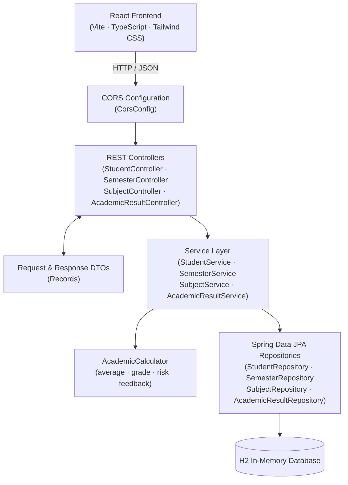
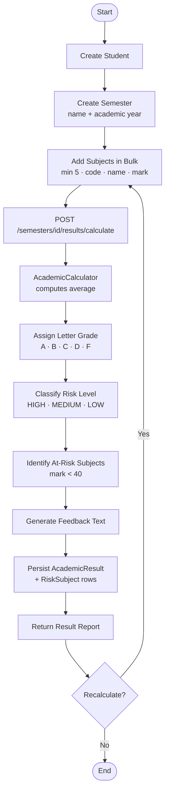
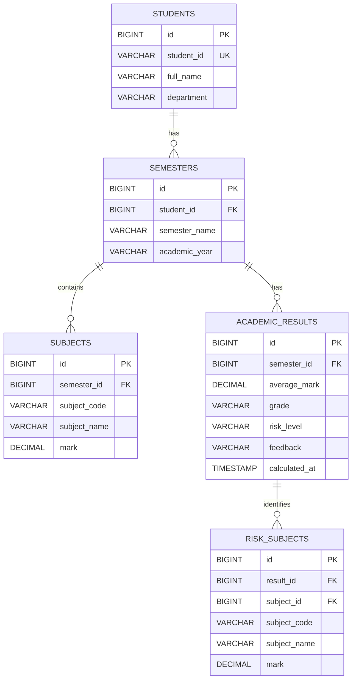

# Academic Survival System
A academic management application built with Spring Boot and React. It helps university students track their academic performance across semesters — logging subjects and marks, calculating semester averages and grades, identifying at-risk subjects, and surfacing actionable feedback to support academic recovery.

---

## Table of Contents
1. [Features](#features)

2. [Technology Stack](#technology-stack)

3. [Architecture](#architecture)

4. [Project Flow](#project-flow)

5. [Database Design](#database-design)

6. [Folder Structure](#folder-structure)

7. [API Documentation](#api-documentation)

8. [Installation and Setup](#installation-and-setup)

9. [API Request Examples](#api-request-examples)

10. [Testing](#testing)

---

## Features
### Implemented
**Student Management**
- Create, read, update, and delete student records.

- Each student has a unique student ID, full name, and department.

- Duplicate student ID detection on create and update.

**Semester Management**
- Create, read, update, and delete semesters linked to a student.

- Each semester records a name (e.g., "Semester 1") and an academic year (e.g., "2024-2025").

- Filter semesters by academic year via query parameter.

**Subject Management**
- Add subjects to a semester in bulk (minimum five subjects required per calculation).

- Each subject records a subject code, subject name, and numeric mark (0-100).

- Duplicate subject code detection within the same semester.

- Update and delete individual subjects.

**Academic Result Calculation**
- Trigger on-demand calculation for any semester with at least five subjects.

- Calculates the arithmetic average of all subject marks, rounded to two decimal places.

- Assigns a letter grade based on the average:

| Average | Grade |
|---------|-------|
| >= 80   | A     |
| >= 70   | B     |
| >= 60   | C     |
| >= 40   | D     |
| < 40    | F     |

- Derives an overall academic risk level:

| Average | Risk Level |
|---------|------------|
| < 40    | HIGH       |
| < 60    | MEDIUM     |
| >= 60   | LOW        |

- Generates a text feedback message based on the risk level.

- Identifies individual at-risk subjects (mark < 40) and persists them alongside the result.

- Stores a timestamp for each calculation, supporting result history.

**Result History and Reports**
- Retrieve the latest result for a semester.

- Retrieve full result history for a semester, ordered by calculation time.

- Retrieve all results for a student across all semesters.

- Retrieve a single result by ID.

- Retrieve the at-risk subjects list for any result.

**React Frontend**
- Dashboard with a live student count and quick-action links.

- Student list with search (name, ID, department) and inline delete.

- Student detail view with semester list and navigation.

- Semester detail with subjects table, mark highlights, and a one-click calculate button.

- Subject bulk-entry form (minimum five rows, inline validation).

- Result report page with grade summary, feedback callout, and at-risk subject table.

- Two-step progress indicator when submitting subjects and calculating simultaneously.

- Consistent error and success feedback throughout all forms.

**CORS Configuration**
- Spring Boot backend configured to allow requests from the React dev server (`http://localhost:5173`).

---

## Technology Stack
### Backend
| Technology | Version |
|---|---|
| Java | 25 |
| Spring Boot | 4.1.1 |
| Spring Web MVC | via `spring-boot-starter-webmvc` |
| Spring Data JPA | via `spring-boot-starter-data-jpa` |
| Jakarta Bean Validation / Hibernate Validator | via `spring-boot-starter-validation` |
| H2 Database | runtime scope |
| Lombok | optional |
| SpringDoc OpenAPI (Swagger UI) | 3.1.0 |
| Maven | wrapper included |

### Testing
| Technology | Notes |
|---|---|
| JUnit 5 | via `spring-boot-starter-test` |
| Mockito | via `spring-boot-starter-test` |
| Spring Test / MockMvc | via `spring-boot-starter-webmvc-test` |
| Spring Data JPA Test | via `spring-boot-starter-data-jpa-test` |
| AssertJ | via `spring-boot-starter-test` |

### Frontend
| Technology | Version |
|---|---|
| React | ^19.1.0 |
| React Router DOM | ^7.6.3 |
| TypeScript | ~6.0.3 |
| Vite | ^8.3.4 |
| Tailwind CSS | ^4.3.3 |
| @tailwindcss/vite plugin | ^4.3.3 |

---

## Architecture


The application follows a standard layered architecture:

- **Controllers** accept HTTP requests, delegate to services, and return JSON responses.

- **DTOs** (Java Records) define the API contract separately from the JPA entities.

- **Services** contain business logic, including validation, duplicate checks, and orchestrating the calculator.

- **AcademicCalculator** is a Spring component that performs average computation, grade assignment, risk classification, and feedback generation.

- **Repositories** are Spring Data JPA interfaces; all queries are derived method names with no custom JPQL.

- **Entities** map directly to H2 tables managed by Hibernate with `ddl-auto: create-drop`.

---

## Project Flow


---

## Database Design
The schema is generated automatically by Hibernate from the JPA entity annotations using `ddl-auto: create-drop`. There are no SQL migration files.



> **Note:** Because `ddl-auto` is set to `create-drop`, the entire schema and all data are recreated on every application start and destroyed on shutdown. This is suitable for development only.

---

## Folder Structure
```

academic-survival-system/

├── frontend/                          # React + TypeScript frontend

│   ├── src/

│   │   ├── api/                       # Typed API client (fetch wrapper)

│   │   │   └── client.ts

│   │   ├── components/

│   │   │   ├── layout/                # AppLayout, Sidebar, TopBar

│   │   │   └── ui/                    # Button, Card, FormField, ConfirmDialog, ...

│   │   ├── pages/

│   │   │   ├── DashboardPage.tsx

│   │   │   ├── students/              # StudentsPage, StudentDetailPage, StudentFormPage

│   │   │   ├── semesters/             # SemestersPage, SemesterDetailPage, SemesterFormPage

│   │   │   ├── subjects/              # SubjectsPage, SubjectFormPage

│   │   │   └── results/               # ResultsPage, ResultDetailPage

│   │   ├── types/

│   │   │   └── api.ts                 # TypeScript types mirroring backend DTOs

│   │   ├── App.tsx                    # React Router route definitions

│   │   ├── main.tsx                   # Application entry point

│   │   └── index.css                  # Tailwind CSS entry

│   ├── .env                           # VITE_API_BASE_URL=http://localhost:8081/api/v1

│   ├── package.json

│   ├── tsconfig.json

│   └── vite.config.ts

│

├── src/

│   ├── main/

│   │   ├── java/com/academic_survival_system/

│   │   │   ├── calculaton/            # AcademicCalculator.java

│   │   │   ├── config/                # CorsConfig.java

│   │   │   ├── controller/            # REST controllers (4 files)

│   │   │   ├── dto/

│   │   │   │   ├── request/           # StudentRequest, SemesterRequest, SubjectRequest

│   │   │   │   └── response/          # StudentResponse, SemesterResponse, SubjectResponse,

│   │   │   │                          # AcademicResultResponse, RiskSubjectResponse, ApiError

│   │   │   ├── exception/             # GlobalExceptionHandler + custom exceptions

│   │   │   ├── model/                 # JPA entities: Student, Semester, Subject,

│   │   │   │                          # AcademicResult, RiskSubject

│   │   │   ├── repository/            # Spring Data JPA repositories (4 files)

│   │   │   └── service/

│   │   │       ├── impl/              # Service implementations

│   │   │       └── *.java             # Service interfaces

│   │   └── resources/

│   │       └── application.yaml       # Database, JPA, server configuration

│   └── test/

│       └── java/com/academic_survival_system/

│           ├── AcademicCalculatorTest.java          # Unit tests for AcademicCalculator

│           ├── AcademicSurvivalSystemApplicationTests.java

│           ├── controller/            # Directory exists, no test files present

│           ├── repository/            # Directory exists, no test files present

│           └── service/               # Directory exists, no test files present

│

├── HELP.md

├── mvnw / mvnw\.cmd                    # Maven wrapper

└── pom.xml

```

---

## API Documentation
All routes are prefixed with `/api/v1`. The application also exposes a Swagger UI at `http://localhost:8081/swagger-ui.html` via SpringDoc OpenAPI.

### Students
| Method | Route | Purpose |
|--------|-------|---------|
| `POST` | `/api/v1/students` | Create a student |
| `GET` | `/api/v1/students` | List all students |
| `GET` | `/api/v1/students/{id}` | Get a student by internal ID |
| `PUT` | `/api/v1/students/{id}` | Update a student |
| `DELETE` | `/api/v1/students/{id}` | Delete a student |

**Request body (create / update):**
```json

{

  "studentId": "STU-001",

  "fullName": "John Smith",

  "department": "Computer Science"

}

```

**Validation:** `studentId` max 50 chars (not blank), `fullName` max 100 chars (not blank), `department` max 100 chars (not blank). `studentId` must be unique.

---

### Semesters
| Method | Route | Purpose |
|--------|-------|---------|
| `POST` | `/api/v1/students/{studentId}/semesters` | Create a semester for a student |
| `GET` | `/api/v1/students/{studentId}/semesters` | List semesters (optional `?academicYear=` filter) |
| `GET` | `/api/v1/students/{studentId}/semesters/{semesterId}` | Get a semester by ID |
| `PUT` | `/api/v1/students/{studentId}/semesters/{semesterId}` | Update a semester |
| `DELETE` | `/api/v1/students/{studentId}/semesters/{semesterId}` | Delete a semester |

**Request body (create / update):**
```json

{

  "semesterName": "Semester 1",

  "academicYear": "2024-2025"

}

```

**Validation:** `semesterName` max 50 chars (not blank), `academicYear` max 20 chars (not blank).

---

### Subjects
| Method | Route | Purpose |
|--------|-------|---------|
| `POST` | `/api/v1/semesters/{semesterId}/subjects` | Add subjects in bulk |
| `GET` | `/api/v1/semesters/{semesterId}/subjects` | List all subjects for a semester |
| `GET` | `/api/v1/semesters/{semesterId}/subjects/{subjectId}` | Get a single subject |
| `PUT` | `/api/v1/semesters/{semesterId}/subjects/{subjectId}` | Update a subject |
| `DELETE` | `/api/v1/semesters/{semesterId}/subjects/{subjectId}` | Delete a subject |

**Request body for bulk create** (array, minimum 5 elements enforced by service):

```json

[

  { "subjectCode": "CS101", "subjectName": "Introduction to Programming", "mark": 75.0 },

  { "subjectCode": "MA101", "subjectName": "Calculus I", "mark": 68.5 }

]

```

**Request body for update** (single object):

```json

{ "subjectCode": "CS101", "subjectName": "Introduction to Programming", "mark": 80.0 }

```

**Validation:** `subjectCode` max 30 chars (not blank), `subjectName` max 100 chars (not blank), `mark` between 0.0 and 100.0 (not null). Subject code must be unique within the same semester.

---

### Academic Results
| Method | Route | Purpose |
|--------|-------|---------|
| `POST` | `/api/v1/semesters/{semesterId}/results/calculate` | Calculate and persist a new result |
| `GET` | `/api/v1/semesters/{semesterId}/results` | Get the latest result for a semester |
| `GET` | `/api/v1/semesters/{semesterId}/results/history` | Get full result history for a semester |
| `GET` | `/api/v1/results/{resultId}` | Get a result by ID |
| `GET` | `/api/v1/students/{studentId}/results` | Get all results for a student |
| `GET` | `/api/v1/results/{resultId}/risk-subjects` | Get at-risk subjects for a result |

**Response shape (AcademicResultResponse):**
```json

{

  "id": 1,

  "semesterId": 3,

  "averageMark": 67.40,

  "grade": "C",

  "riskLevel": "LOW",

  "feedback": "Good job! Keep maintaining your academic performance.",

  "calculatedAt": "2024-11-01T14:32:00",

  "riskSubjects": [

    {

      "subjectId": 7,

      "subjectCode": "MA201",

      "subjectName": "Linear Algebra",

      "mark": 35.0

    }

  ]

}

```

---

## Installation and Setup
### Prerequisites
| Requirement | Notes |
|---|---|
| Java 25 | As declared in `pom.xml` |
| Maven | Use the included `mvnw` wrapper - no separate installation required |
| Node.js >= 18 | Required for the React frontend |
| npm | Included with Node.js |

No external database installation is required. The application uses an embedded H2 in-memory database.

### 1. Clone the Repository
```bash

git clone \<your-repository-url>

cd academic-survival-system

```

### 2. Start the Backend
```bash

# On Linux/macOS

./mvnw spring-boot:run

# On Windows

mvnw\.cmd spring-boot:run

```

The backend starts on **port 8081**.

- REST API base: `http://localhost:8081/api/v1`

- Swagger UI: `http://localhost:8081/swagger-ui.html`

- H2 Console: `http://localhost:8081/h2-console`

**H2 Console connection settings:**
```

JDBC URL:  jdbc:h2:mem:academicsurvivaldb

User Name: student

Password:  (leave blank)

```

> **Important:** Because `ddl-auto` is set to `create-drop`, all data is lost when the backend stops.

### 3. Start the Frontend
```bash

cd frontend

npm install

npm run dev

```

The React development server starts on **port 5173** by default: `http://localhost:5173`.

The frontend calls `http://localhost:8081/api/v1` via the `.env` file:

```

VITE_API_BASE_URL=http://localhost:8081/api/v1

```

Both servers must be running simultaneously for the full application to function.

---

## Core API Quick Reference
The five essential endpoints that drive the complete academic workflow:

| # | Method | Route | Purpose |
|---|--------|-------|---------|
| 1 | `POST` | `/api/v1/students` | Create a student |
| 2 | `POST` | `/api/v1/students/{studentId}/semesters` | Create a semester for a student |
| 3 | `POST` | `/api/v1/semesters/{semesterId}/subjects` | Add subjects in bulk (min. 5) |
| 4 | `POST` | `/api/v1/semesters/{semesterId}/results/calculate` | Calculate grade, risk level, and feedback |
| 5 | `GET` | `/api/v1/results/{resultId}` | Retrieve the full result report |

The full API reference — including GET, PUT, DELETE, and history endpoints — is documented in the [API Documentation](#api-documentation) section and available interactively at `http://localhost:8081/swagger-ui.html`.

## Testing
The project uses **JUnit 5** via `spring-boot-starter-test`.

| File | Type | What is tested |
|---|---|---|
| `AcademicCalculatorTest.java` | Unit — 12 methods | Grade A/B/C/D/F boundaries, risk level HIGH/MEDIUM/LOW, mark range validation (rejects >100), null input rejection, feedback text per risk level |
| `AcademicSurvivalSystemApplicationTests.java` | Context load | Spring application context starts without errors |

### Run the tests
```bash

# Linux / macOS

./mvnw test

# Windows

mvnw\.cmd test

```
