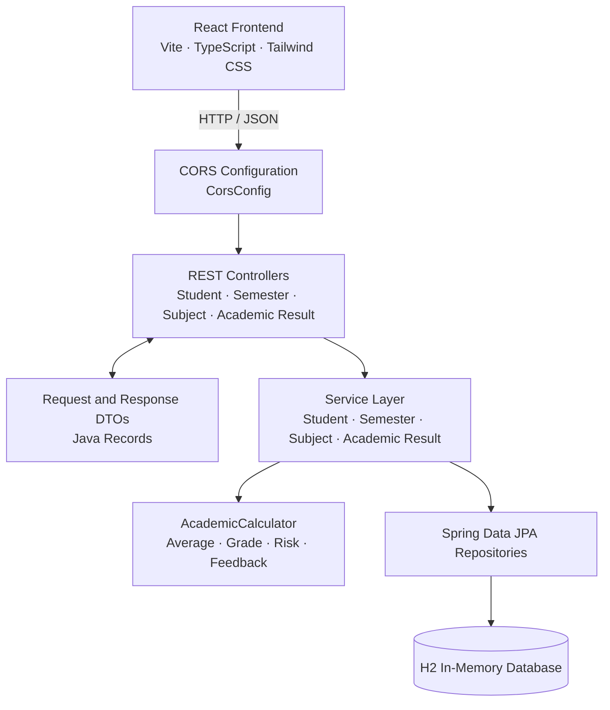
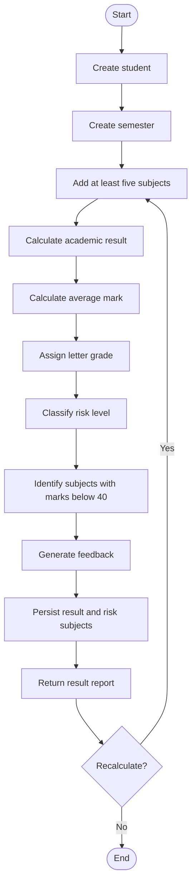
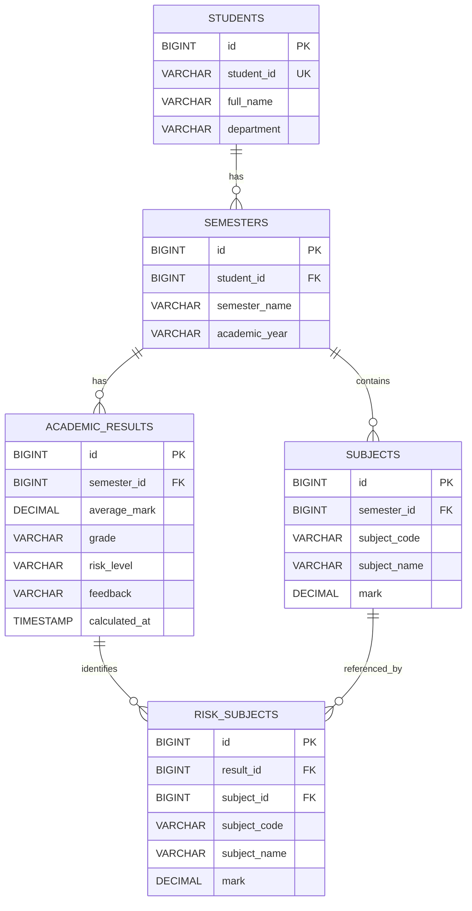

# Academic Survival System

An academic management application built with **Spring Boot** and **React**. It helps university students track academic performance across semesters, manage subjects and marks, calculate semester averages and grades, identify at-risk subjects, and receive feedback to support academic recovery.

## Table of Contents

- [Features](#features)
- [Technology Stack](#technology-stack)
- [Architecture](#architecture)
- [Project Workflow](#project-workflow)
- [Database Design](#database-design)
- [Core API Reference](#core-api-reference)
- [Installation and Setup](#installation-and-setup)
- [Testing](#testing)

## Features

### Student Management
- Create, retrieve, update, and delete student records.
- Store a unique student ID, full name, and department.
- Detect duplicate student IDs during creation and updates.

### Semester Management
- Manage semesters associated with a student.
- Store a semester name and academic year.
- Filter semesters by academic year.

### Subject Management
- Add multiple subjects to a semester in one request.
- Store each subject's code, name, and mark.
- Require at least five subjects for an academic result calculation.
- Validate marks from `0` to `100` and prevent duplicate subject codes within a semester.
- Update and delete individual subjects.

### Academic Result Calculation
- Calculate and persist the arithmetic average of subject marks, rounded to two decimal places.
- Assign a letter grade based on the average.
- Classify the overall academic risk level and generate feedback.
- Identify individual at-risk subjects with marks below `40`.
- Store calculation timestamps to support result history.

Grade thresholds:

| Average mark | Grade |
|---:|:---:|
| 80 or above | A |
| 70–79.99 | B |
| 60–69.99 | C |
| 40–59.99 | D |
| Below 40 | F |

Risk thresholds:

| Average mark | Risk level |
|---:|---|
| Below 40 | HIGH |
| 40–59.99 | MEDIUM |
| 60 or above | LOW |

### Result History and Reports
- Retrieve the latest result for a semester.
- Retrieve a semester's calculation history.
- Retrieve all results for a student.
- Retrieve an individual result and its at-risk subjects.

### React Frontend
- Dashboard with student count and quick actions.
- Student and semester list/detail views.
- Subject entry and mark validation.
- Result reports with grade summaries, feedback, and at-risk subjects.
- Success and error feedback throughout the forms.

## Technology Stack

### Backend

| Technology | Version / purpose |
|---|---|
| Java | 25 |
| Spring Boot | 4.1.1 |
| Spring Web MVC | REST API |
| Spring Data JPA | Persistence layer |
| Jakarta Bean Validation / Hibernate Validator | Request validation |
| H2 Database | Embedded in-memory database |
| Lombok | Boilerplate reduction |
| SpringDoc OpenAPI | 3.1.0; Swagger UI |
| Maven | Build tool; Maven Wrapper included |

### Frontend

| Technology | Version |
|---|---|
| React | `^19.1.0` |
| React Router DOM | `^7.6.3` |
| TypeScript | `~6.0.3` |
| Vite | `^8.3.4` |
| Tailwind CSS | `^4.3.3` |
| `@tailwindcss/vite` | `^4.3.3` |

### Testing
- JUnit 5
- Mockito
- Spring Test / MockMvc
- Spring Data JPA Test
- AssertJ

## Architecture

The application uses a layered backend architecture with a React frontend. The controller layer handles HTTP requests, DTOs define the API contract, services coordinate business rules, `AcademicCalculator` computes academic outcomes, and Spring Data JPA repositories access the database.



### Layer responsibilities

- **Controllers:** Accept HTTP requests, delegate to services, and return JSON responses.
- **DTOs:** Define request and response payloads separately from persistence entities.
- **Services:** Apply validation, duplicate checks, and application business rules.
- **AcademicCalculator:** Computes the average, assigns a grade and risk level, and generates feedback.
- **Repositories:** Use Spring Data JPA repository methods to access persisted entities.
- **Entities:** Map the domain model to database tables through JPA and Hibernate.

## Project Workflow



## Database Design

The database schema is generated by Hibernate from the JPA entity annotations. The application uses an H2 in-memory database and `ddl-auto: create-drop`; no SQL migration files are configured.



> **Development note:** With `ddl-auto: create-drop`, Hibernate recreates the schema when the application starts and drops it when the application shuts down. Data is not retained between application runs. This configuration is suitable for development, not production.

## Core API Reference

All API routes use the `/api/v1` prefix. These five endpoints demonstrate the main academic workflow.

| # | Method | Endpoint | Purpose |
|---:|---|---|---|
| 1 | `POST` | `/api/v1/students` | Create a student |
| 2 | `POST` | `/api/v1/students/{studentId}/semesters` | Create a semester for a student |
| 3 | `POST` | `/api/v1/semesters/{semesterId}/subjects` | Add subjects in bulk; at least five are required for calculation |
| 4 | `POST` | `/api/v1/semesters/{semesterId}/results/calculate` | Calculate and save the academic result |
| 5 | `GET` | `/api/v1/results/{resultId}` | Retrieve a result report |

### Example request payloads

Create a student:

```json
{
  "studentId": "STU-001",
  "fullName": "John Smith",
  "department": "Computer Science"
}
```

Create a semester:

```json
{
  "semesterName": "Semester 1",
  "academicYear": "2026-2027"
}
```

Add subjects in bulk:

```json
[
  {
    "subjectCode": "CS101",
    "subjectName": "Introduction to Programming",
    "mark": 75.0
  },
  {
    "subjectCode": "MA101",
    "subjectName": "Calculus I",
    "mark": 68.5
  },
  {
    "subjectCode": "EN101",
    "subjectName": "Academic English",
    "mark": 82.0
  },
  {
    "subjectCode": "IT101",
    "subjectName": "Computer Fundamentals",
    "mark": 59.0
  },
  {
    "subjectCode": "PH101",
    "subjectName": "Physics",
    "mark": 35.0
  }
]
```

The example payloads illustrate the request shape. The application validates required fields, mark ranges, unique student IDs, and subject-code uniqueness within a semester.

Swagger UI is available at `http://localhost:8081/swagger-ui.html` when the backend is running.

## Installation and Setup

### Prerequisites

- Java 25
- Node.js 18 or later
- npm

The Maven Wrapper is included, so a separate Maven installation is not required. The backend uses an embedded H2 database; no separate database server is required.

### 1. Clone the repository

```bash
git clone <your-repository-url>
cd academic-survival-system
```

Replace `<your-repository-url>` with your repository URL.

### 2. Start the backend

Linux / macOS:

```bash
./mvnw spring-boot:run
```

Windows:

```bat
mvnw.cmd spring-boot:run
```

The backend runs on port `8081` by default.

- API base URL: `http://localhost:8081/api/v1`
- Swagger UI: `http://localhost:8081/swagger-ui.html`
- H2 Console: `http://localhost:8081/h2-console`

H2 Console connection settings:

```text
JDBC URL: jdbc:h2:mem:academicsurvivaldb
User Name: student
Password: (leave blank)
```

### 3. Start the frontend

Open another terminal:

```bash
cd frontend
npm install
npm run dev
```

The Vite development server is available at `http://localhost:5173` by default.

Configure the frontend API base URL in `frontend/.env`:

```dotenv
VITE_API_BASE_URL=http://localhost:8081/api/v1
```

Run both the backend and frontend to use the full application.

## Testing

The project uses JUnit 5 through `spring-boot-starter-test`.

| Test class | Coverage |
|---|---|
| `AcademicCalculatorTest.java` | Grade and risk-level boundaries, mark-range validation, null-input rejection, and feedback by risk level |
| `AcademicSurvivalSystemApplicationTests.java` | Spring application context startup |

Run the tests from the project root.

Linux / macOS:

```bash
./mvnw test
```

Windows:

```bat
mvnw.cmd test
```
